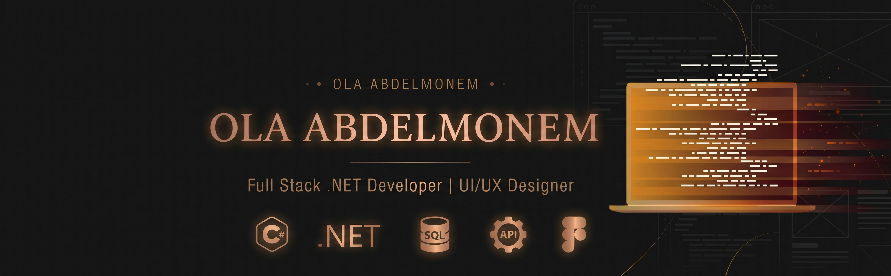

  

# Hi there, I'm Ola! 👋

### 👩‍💻 Full Stack .NET Developer | UI/UX Designer

I am a passionate CS student at the Higher Institute for Computer Science and Information Systems, bridging the gap between design and development. I love crafting intuitive user experiences and bringing them to life through clean, efficient code. 

- 🎓 Constantly exploring new tech realms, from **Frontend Web Development** and **Cross-platform Mobile Apps** to **Backend Engineering**.
- 🚀 Continuously upskilling through intensive bootcamps and scholarships (DEPI, AWS AI & ML Scholars, NTI).
- 🎨 Active in UI/UX design, creating wireframes, interactive prototypes, and full design systems.
- 💡 Fun fact: I also enjoy 3D modeling and scene design!

---

### 🛠️ Tech Stack & Tools

**Design & 3D:**
 

**Frontend:**
    

**Backend, DB & Security:**
   

---

### 📂 Featured Projects & Concepts

*   **Ta3afy (تعافي):** Designed the complete UI/UX architecture, prototype flows, and database ERD for a health-focused mobile application.
*   **TinyNest:** Formulated user personas, wireframes, and Figma interfaces for a child-focused digital launcher application concept.
*   **Usus Academy (أسُس):** Collaborated on designing intuitive UI layouts and navigation components for an educational platform.

---

### 📫 Let's Connect!

<!-- استبدلي علامات الشباك # باللينكات الحقيقية بتاعتك -->

